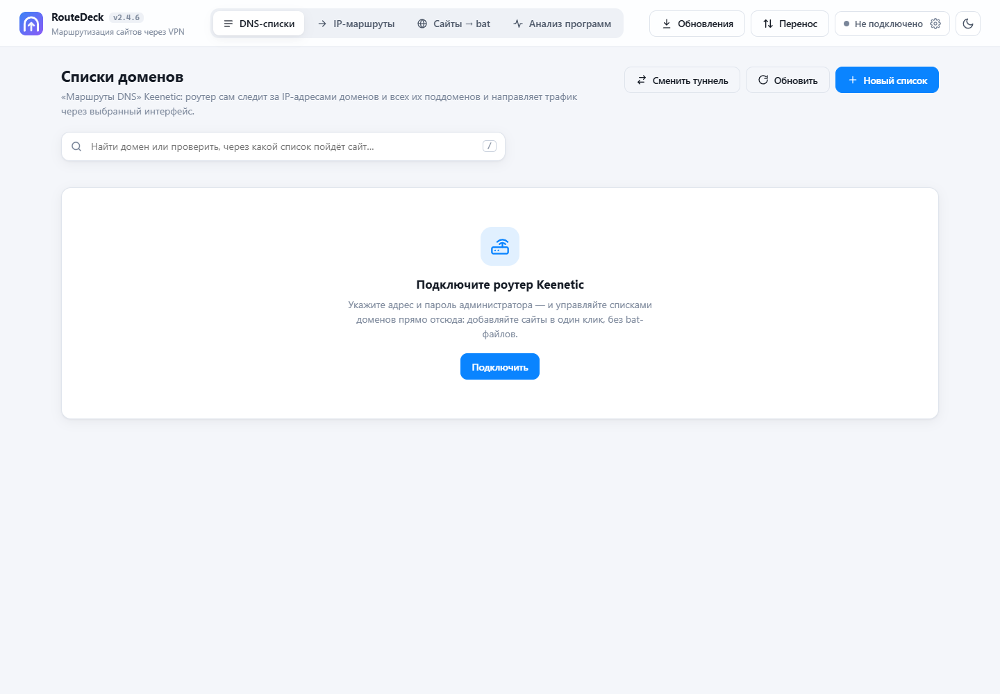
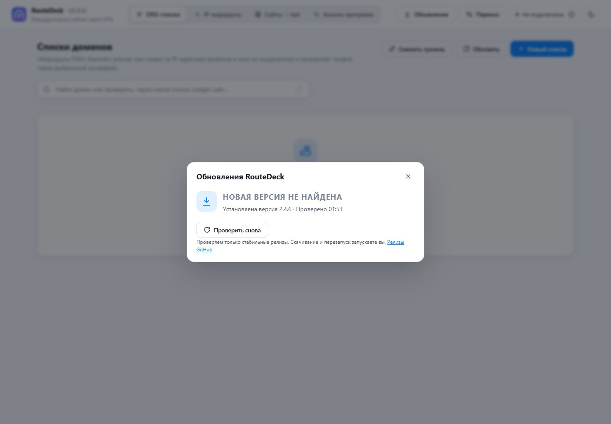
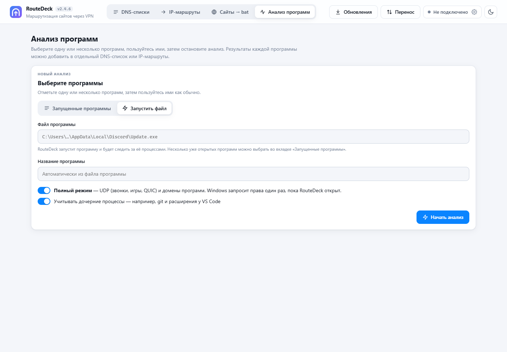

# RouteDeck

**Сайты и программы через нужный VPN-туннель на Keenetic — в одном окне.**

RouteDeck — настольная программа для Windows с локальным веб-интерфейсом. Она управляет DNS-списками и IP-маршрутами роутера Keenetic через RCI API. Ранее проект назывался **Sites4Router**.

## Обновления через GitHub

В **2.4.14** DNS-списки можно показывать строками и объединять, IP-группы — объединять и сворачивать все сразу. Анализ нескольких программ показывает общие результаты и умеет сам добавлять новые адреса на роутер; программы с одинаковым названием считаются одной. Историю анализа можно удалить целиком. Описание новой версии показывается с оформлением. Обновление больше не оставляет рядом с программой старый EXE и не создаёт второй значок на панели задач.

В **2.4.13** уточнена подсказка экспорта для AmneziaVPN: когда Amnezia сама находит IP доменов (ручное добавление через «+»; подключение по OpenVPN, Cloak, Shadowsocks или XRay на компьютере), когда нет (AmneziaWG/WireGuard, телефоны), что IP со временем меняются и что нужна AmneziaVPN 5.0.1 или новее.

В **2.4.12** появился экспорт для AmneziaVPN. В окне переноса выберите формат «AmneziaVPN»: DNS-списки и IP-маршруты сохраняются в файл, который импортируется в Amnezia в разделе «Раздельное туннелирование» → «Сайты». AmneziaVPN не ищет IP доменов при импорте, а с AmneziaWG/WireGuard и на телефонах домен без IP не работает. Поэтому RouteDeck сам находит IP доменов и их www-вариантов. IPv6 и адреса домашней сети в файл не попадают.

В **2.4.11** добавлен вход в роутеры с KeeneticOS 5.2. Новая прошивка переводит пароль на схему NDW4 и после этого отклоняет прежний способ входа даже с верным паролем. RouteDeck выбирает схему сам: NDW4, если роутер её поддерживает для учётной записи, иначе прежний способ.

В **2.4.10** RouteDeck бережнее обращается с роутером. После неверного пароля программа больше не повторяет вход, пока не изменены настройки, поэтому защита Keenetic от подбора пароля не блокирует компьютер на 15 минут. В настройках появилась кнопка «Забыть пароль». Маршруты к адресам домашней сети через туннель не создаются. Крупные операции, например перенос сотен маршрутов, больше не завершаются ложной ошибкой «Роутер недоступен». Если уже запущена другая версия RouteDeck, новая предлагает её закрыть, а не завершается молча.

В **2.4.9** исправлен перезапуск после встроенного обновления: новая версия больше не показывает ошибку «Failed to load Python DLL».

В **2.4.8** RouteDeck сам проверяет обновления при запуске и сообщает о новой версии уведомлением; номер версии виден на кнопке в верхней панели. Импорт стал проще: добавляется только новое, существующее пропускается, а описания IP-маршрутов обновляются по файлу. В анализе программ объединение IP в подсети /24 включено по умолчанию, параметры добавления всегда видны.

В **2.4.7** проверка обновлений обозначена круговыми стрелками. Кнопки обновления и переноса в верхней панели показывают только значки; подсказки доступны при наведении.

Начиная с **2.4.6** доступна проверка стабильных релизов: новая версия подсвечивается в верхней панели. Значок проверки обновлений позволяет проверить вручную, прочитать изменения и скачать EXE с проверкой SHA-256. В настольном EXE доступно **Обновить и перезапустить** с отдельным подтверждением; в браузере — сохранение EXE для ручной замены. [Подробности и защита загрузки](docs/updates.md).

Версия 2.4.5 не содержит встроенного обновления: переход на 2.4.6 выполняется один раз вручную из релиза.

## Интерфейс







Настоящий интерфейс версии 2.4.6, запущенный из исходников с отдельной пустой базой. Роутер не подключён; анализ трафика не запускался. Личные настройки и история в снимках отсутствуют.

## Возможности

| Раздел | Что можно сделать |
| --- | --- |
| Маршруты DNS | Создавать списки доменов и подсетей, назначать интерфейс VPN, включать и выключать правила, переключать туннель для нескольких списков. Показывать списки карточками или строками, объединять выбранные списки. |
| IP-маршруты | Управлять маршрутами IPv4, группировать по описанию, объединять группы, сворачивать и разворачивать все группы, менять интерфейс, копировать и экспортировать маршруты. |
| Сайты → BAT | Получать IP через несколько DNS-серверов и создавать BAT-файлы для импорта маршрутов. |
| Анализ программ | Находить домены и IP выбранных программ, смотреть результаты по каждой или по всем сразу, сохранять историю и переносить записи в DNS-списки или IP-маршруты — вручную или автоматически по мере обнаружения. |
| Перенос | Экспортировать и импортировать DNS-списки и IP-группы между роутерами, сопоставляя интерфейсы. Импорт добавляет только новое и обновляет описания; полная замена — отдельной отметкой «Сначала очистить роутер». Экспорт в список раздельного туннелирования AmneziaVPN. |

Обычный анализ использует таблицу TCP-соединений Windows и кэш DNS. Полный анализ запускает отдельный сборщик ETW с подтверждением UAC; он поддерживает UDP, DNS и извлечение SNI. До запуска анализа сборщик не работает.

## Готовая программа

Скачайте `RouteDeck.exe` из [последнего релиза RouteDeck](https://github.com/MBudkin/RouteDeck/releases/latest) и запустите на Windows 10/11. Python для EXE не требуется. Для встроенного окна используется Microsoft Edge WebView2; при его отсутствии предусмотрен запуск интерфейса в браузере.

Нажмите **Настройки роутера**, укажите адрес Keenetic и учётные данные, затем выберите нужный VPN-интерфейс. Туннель на роутере должен быть настроен заранее. Для DNS-маршрутизации нужны соответствующие функции KeeneticOS (в README исходного проекта указаны версии 4.3+/5.x).

Данные EXE хранятся в `%APPDATA%\RouteDeck`: база сайтов, настройки, журналы и история анализа. На Windows пароль защищается DPAPI для текущей учётной записи. Эти файлы не входят в репозиторий.

## Запуск из исходников

Нужен Python 3 в Windows; для сборочных BAT-файлов — Python Launcher `py`.

```powershell
py -3 -m venv .venv
.\.venv\Scripts\Activate.ps1
python -m pip install -r requirements.txt
python desktop.py
```

Для запуска веб-интерфейса можно использовать `start.bat`: сервер слушает `127.0.0.1:5000`. Настольный режим выбирает свободный локальный порт, предпочитая `47815`.

Чтобы работать с отдельной базой при запуске исходников:

```powershell
$env:S4R_DATA_DIR = "$env:TEMP\RouteDeck-demo"
python desktop.py
```

## Сборка и проверки

```powershell
.\build.bat
py -3 -m unittest discover -s tests -v
py -3 tests/run_browser_updates.py
py -3 tests\run_browser_capture.py
py -3 tests\run_browser_capture.py --suite dns
py -3 tests\run_browser_capture.py --suite ip
```

`build.bat` устанавливает зависимости сборки, создаёт значок и сведения о версии, затем собирает `dist\RouteDeck.exe` через PyInstaller. Проверки браузера используют установленный Chrome и тестовые ответы, не настоящий роутер.

## Структура проекта

```text
app.py, desktop.py, version.py   сервер, настольное окно, версия
services/                       Keenetic, база, DNS, перенос, анализ трафика
templates/, static/             HTML, JavaScript, CSS и значки
tools/                          генерация ресурсов сборки
tests/                          проверки логики и интерфейса
build.bat, RouteDeck.spec        сборка EXE
docs/                           снимки и инструкции синхронизации
```

Локальные базы, настройки, списки пользователя, резервные копии, журналы, профиль браузера и результаты сборок исключены. EXE распространяется отдельно как asset релиза. [Как устроена локальная синхронизация](docs/sync.md).

## Подсказки по маршрутизации

DNS-списки удобны для сайтов с меняющимися IP и CDN: запись домена охватывает поддомены. Устройства должны обращаться к DNS роутера, чтобы Keenetic видел запросы. IP-маршруты подходят для известных подсетей сервисов. Эксклюзивный маршрут позволяет запретить прямой выход при недоступном туннеле.
